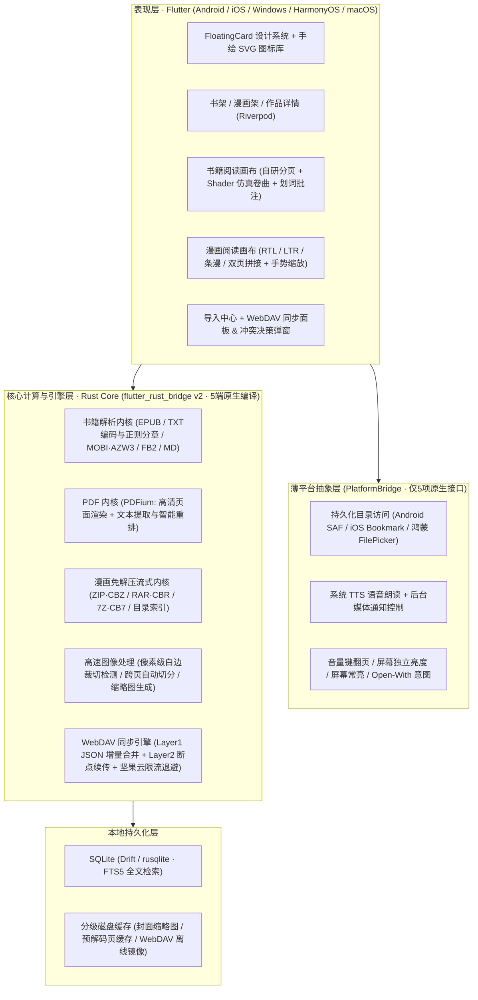

# 墨匣（InkBox）— Phase 2 技术选型与跨平台架构方案

> **阶段**：Phase 2 — 技术选型与系统架构设计（待您确认后进入 Phase 3 工程搭建与开发）  
> **平台路线**：**Android (V1.0 首发)** → **iOS** → **Windows** → **鸿蒙 (HarmonyOS NEXT)** → **macOS**  
> **功能范围**：V1.0 全量功能（含书籍仿真卷曲/TTS/PDF 重排、漫画智能裁边/跨页切分/双页拼接、WebDAV Layer 1+Layer 2 全层同步、FloatingCard + 手绘单色线性图标体系）

---

## 1. 跨五端技术路线综合对比

结合您的核心诉求——**首期在 Android 做出媲美 Legado/Mihon 的高帧率流畅阅读体验，同时未来低成本演进至 iOS、Windows、鸿蒙 NEXT、macOS**——我们对 2026 年三大主流技术路线做实事求是的横向对比：

| 评估维度 | **方案 A（推荐首选）：Flutter + Rust Core** | **方案 B：KMP + Compose Multiplatform** | **方案 C：Android 原生 + 共享 Rust Core** |
| :--- | :--- | :--- | :--- |
| **五端覆盖能力** | **极佳**：Android / iOS / Windows / macOS 官方稳定支持；鸿蒙 NEXT 由 OpenHarmony SIG (`flutter_flutter` 3.27/3.35-ohos) 成熟支持，60fps 稳定 | **良好**：Android / iOS / Desktop(JVM) 稳定；鸿蒙 NEXT 已有社区 KMP 2.2 / CMP 1.9 适配，但桌面与鸿蒙三方插件体量仍小于 Flutter | **高维护成本**：仅底层逻辑复用，后续 iOS (SwiftUI)、Windows (WinUI/Tauri)、鸿蒙 (ArkUI) 需重写多套 UI |
| **FloatingCard + 手绘图标 + 仿真卷曲** | **满分**：自绘引擎（Impeller/Skia）+ Fragment Shader 贝塞尔卷曲，FloatingCard 毛玻璃阴影与手绘 SVG 在 5 端像素级 100% 一致 | **优秀**：Compose Canvas + Skiko 可实现同样效果，但在 iOS/鸿蒙上的自定义 Shader 与复杂输入法细节踩坑略多 | **Android 最顺手**，但每扩展一个平台都要重新实现一遍动效与 UI |
| **重度解析性能（RAR/7Z/MOBI/大TXT/像素裁边）** | **满分**：全部下沉到 **Rust Core (`flutter_rust_bridge` v2)**，一套 Rust 代码编译为 5 端原生二进制，零 GC 卡顿 | 同等可行（Kotlin/Native + JNI 或同样桥接 Rust），但多端 JNI / cinterop 胶水配置较繁琐 | 同样依托 Rust Core，Android 通过 JNI/UniFFI 调用 |
| **安装包体积与桌面体验** | 移动端 ~25–35 MB，Windows/macOS 原生编译（无需自带 JVM） | 移动端 ~25 MB，但 Windows/macOS 需打包 JVM Runtime（~70–110 MB） | Android ~18–25 MB，体积最轻 |
| **单人/小团队总研发投入** | **最低（1 套 UI + 1 套 Rust 引擎覆盖 5 端）** | 中等（Kotlin 统一语言，但多端平台差异调试成本略高于 Flutter） | 最高（多端 UI 重复建设） |

> [!TIP]
> **核心推荐：方案 A — `Flutter (Dart) + Rust Core (flutter_rust_bridge v2) + 极薄 PlatformBridge`**  
> 这是目前业界（包括开源多端阅读器、笔记软件、同步工具）落地 **「Android → iOS → Windows → 鸿蒙 → macOS」** 五端同构的最优解：
> - **UI 层（Flutter）**：一套代码精准还原 **FloatingCard 悬浮毛玻璃美学**、**自定义手绘单色 SVG 图标**与 **60/120Hz 贝塞尔仿真翻页动效**。
> - **计算与格式引擎层（Rust）**：天然跨所有 5 个平台编译，彻底避开 Dart 在 `RAR/CBR`、`7Z/CB7`、`MOBI/AZW3`、超大 TXT 正则分章、像素级白边裁切、流式 SHA-256 哈希和 WebDAV 断点续传上的生态短板。
> - **平台原生能力层（极薄 PlatformBridge）**：仅把 5 个强平台相关的能力（SAF 文件夹持久化授权、系统 TTS、屏幕亮度/常亮、音量键翻页拦截、文件关联 Open-With）抽象成统一接口；Android 首发写 Kotlin 实现，后续扩展 iOS / Windows / 鸿蒙 / macOS 时只需按接口补齐对应平台的少量桥接代码即可！

---

## 2. 推荐架构全景图（方案 A：Flutter + Rust Core）



---

## 3. V1.0 全量功能逐模块技术选型明细

### 3.1 UI 框架、状态管理与本地数据库

| 模块 | 选型 | 说明 |
| :--- | :--- | :--- |
| **跨端 UI 框架** | **Flutter 3.27+ (稳定版，对齐鸿蒙 OHOS 分支版本线)** | 锁定与 `openharmony-tpc/flutter_flutter` 对齐的主版本，确保后续接入鸿蒙无需大规模降级或改 API |
| **状态管理** | **Riverpod 2.x (Codegen)** | 编译期安全、细粒度局部刷新（翻页/滑块拖拽不触发整棵组件树重建）、极易编写单元测试 |
| **路由导航** | **GoRouter** | 声明式路由，原生支持 Android 预测性返回手势与外部文件 `Open With` DeepLink |
| **手绘单色图标** | **自定义矢量 SVG 字体（`.ttf` IconFont）或 `flutter_svg`** | 将整套手绘细线图标打包为矢量字体或预编译 `.vec` (`vector_graphics`)，零栅格锯齿、随日/夜/Monet 主题自动着墨 |
| **本地数据库** | **SQLite (`drift` + FTS5)** | 强类型响应式查询，支持书架万级藏书毫秒检索、全书章节/笔记全文索引（FTS5）、迁移安全 |
| **主题与动态取色** | **`dynamic_color` + 自研 `InkBoxThemeExtension`** | 同时支持 Android Monet 动态取色、内置青墨暖纸/暗夜/OLED 主题，以及 `FloatingCard` vs `Classic` 样式令牌切换 |

---

### 3.2 书籍阅读引擎（对标 Legado + 静读天下）

这是最核心、最考验体验的模块。为了在 V1.0 同时兼顾 **极致排版流畅度、仿真卷曲翻页、PDF 重排、全格式覆盖**，采用 **「Rust 解析 + Flutter 自研高性能分页画布」** 方案：

1. **格式解析层（Rust 统一输出标准化 AST 章节模型）**：
   - **EPUB 2 / 3**：`epub` / `zip` + `roxmltree` + `scraper`（解析 OPF 元数据、NCX/NAV 目录、章节 HTML、内嵌 CSS 子集、插图资源与脚注引用）。
   - **TXT**：`chardetng` + `encoding_rs`（精准自动识别 UTF-8 / GB18030 / GBK / Big5 / UTF-16LE）+ `regex`（Rust 原生多线程正则分章，15MB 长篇小说 < 150ms 完成索引，支持用户自定义分章正则与净化替换规则）。
   - **MOBI / AZW3 (KF8)**：Rust `mobi` crate + KF8 HTML 解包器，直接转译为与 EPUB 一致的统一章节 AST。
   - **FB2 / Markdown**：`quick-xml`（FB2）与 `pulldown-cmark`（Markdown），统一接入同一套排版渲染管道。
   - **PDF 双模引擎**：集成 **PDFium**（通过 `pdfrx` 或 Rust `pdfium-render`）：
     - *原版页面模式*：GPU 瓦片高清缩放 + 自动切白边；
     - *智能文本重排模式（Reflow）*：调用 PDFium 逐行提取文字坐标与段落边界，经启发式断行合并（消除硬换行与页眉页脚）后送入书籍分页引擎，实现 PDF 像 EPUB 一样调字号、换纸张配色、仿真翻页！
2. **排版与分页引擎（Flutter `TextPainter` + 后台增量预排版）**：
   - 使用 `ParagraphBuilder` / `TextPainter` 对当前章及前后相邻章节进行精准行/页切分（支持首行缩进、段距、字距、行距、对齐、繁简转换 `opencc-rust`、内嵌插图图文混排）。
   - 排版结果按 `(book_id, chapter_idx, layout_hash)` 缓存到内存与轻量索引，二次打开秒开且不丢精确字符偏移量（`chapter_index + char_offset`，字号变化时阅读位置精准锚定，绝不漂移）。
3. **翻页动画（4 种全覆盖）**：
   - **仿真卷曲（Bezier Page Curl）**：采用 Flutter **GLSL Fragment Shader (`FragmentProgram`)** + `Picture` 离屏纹理捕捉前后两页，实时计算跟手卷曲折线、页背透印与柔和折痕阴影，120Hz 高刷屏丝滑无掉帧。
   - **覆盖 / 左右平滑滑动 / 上下无缝滚动 + 自动滚屏**：基于自研手势状态机统一托管，与 **Legado 风格九宫格自定义点击区** 无缝协同。
4. **划词批注与 TTS 听书**：
   - 精准字盒命中测试（`getPositionForOffset` / `getBoxesForSelection`）实现拖动手柄划词、多色高亮、气泡笔记与 Markdown 导出。
   - **TTS 听书**：通过 `PlatformBridge` 桥接 Android 原生 `TextToSpeech` + `MediaSession` 锁屏/通知栏播放控制，正文实时高亮当前朗读句并自动翻页。

---

### 3.3 漫画阅读引擎（对标 Mihon / Tachiyomi）

漫画核心痛点是 **大图 OOM、翻页闪烁、多格式压缩包卡顿、跨页/白边体验差**：

1. **免解压流式读取（Rust `ComicArchive` 抽象）**：
   - **CBZ / ZIP**：Rust `zip`（随机偏移直读单页字节流，无需解压全包）。
   - **CBR / RAR**：Rust 绑定 `unrar` C++ 原生库（支持 RAR4/RAR5 流式单条目提取）。
   - **CB7 / 7Z**：Rust `sevenz-rust` / `lzma-rs`（带目录缓存，避免重复解固实压缩头）。
   - **PDF 漫画 / 本地图片文件夹**：PDFium 图像渲染流 / 自然排序（Natural Sort，确保 `2.jpg` 排在 `10.jpg` 之前）直读 JPG/PNG/WebP/AVIF。
   - 自动解析 `ComicInfo.xml`（作者、卷号、简介、阅读方向提示）。
2. **Rust 高速图像处理管道**：
   - **智能白边裁切（Auto Crop）**：在 Rust 侧对降采样缩略图扫描四边亮度方差，毫秒级算出内容包围盒（Bounding Box），渲染时直接按 Rect 裁剪显示，手机屏幕有效画面增大 15%–25%。
   - **跨页宽图自动切分（Auto Split）**：检测到 `width > height * 1.15` 且处于单页模式时，虚拟拆分为两页（按 RTL 先右后左 / LTR 先左后右），翻页计数器无缝衔接。
   - **双页拼接（Dual Page）**：横屏/平板/折叠屏状态下自动将连续两张竖图无缝拼合展示（智能识别封面单页与宽幅跨页不错位）。
3. **流畅阅读与内存防爆**：
   - 滑动/翻页预加载滑动窗口：**预解码前 2 页 + 后 4 页**，超出窗口自动释放纹理。
   - 条漫模式（Webtoon）：采用 `CustomScrollView` + 已知宽高比占位防跳动 + 超长竖图分块切片渲染（Tile Decoding），避免单张 20000px 长图触发 GPU 纹理尺寸上限。
   - 滤镜与调光：通过 Flutter `ColorFiltered` + GPU 颜色矩阵实现零损耗实时暖色护眼滤镜、灰度/对比度增强与暗室超低亮度遮罩。

---

### 3.4 本地智能导入系统

- **Android 存储权限合规**：完全基于 **Android SAF (`ACTION_OPEN_DOCUMENT` & `ACTION_OPEN_DOCUMENT_TREE`)** 持久化 Uri 授权（`takePersistableUriPermission`），无需申请会被商店拒审的高危 `MANAGE_EXTERNAL_STORAGE` 权限（同时为侧载版/高级用户预留可选全盘扫描开关）。
- **流式指纹去重**：计算文件头 64KB + 文件尾 64KB + 文件总大小的快速指纹（导入确认后再异步补全完整 SHA-256），大漫画包秒级判重。
- **智能分拣规则**：扩展名判定 + PDF 图文占比快速采样（扫描前 3 页判断纯图 PDF 自动建议入漫画架，文本 PDF 自动建议入书架）。

---

### 3.5 WebDAV 多端同步引擎（Layer 1 + Layer 2 全落地）

将同步核心编写在 **Rust (`reqwest` + `tokio`)** 中，天然实现五端逻辑一致：

1. **协议兼容与坚果云适配**：
   - 标准 WebDAV (`PROPFIND`, `MKCOL`, `GET`, `PUT`, `DELETE`, `HEAD` ETag 检测)，内置 **坚果云 / Alist / Nextcloud / 群晖 NAS** 一键预设模板。
   - **请求节流与退避队列**：针对坚果云 30 分钟请求配额限制，Layer 1 所有元数据与进度打包为压缩 JSON 单次读写，写入增加防抖（离开阅读器后延迟 3 秒合并上传），遇到 `429 / 503` 自动指数退避重试。
2. **Layer 1 增量状态与冲突决策**：
   - 每条进度携带 `{ content_hash, locator, progress, updated_at_utc, device_id, device_name }`；
   - 书签与划线笔记采用 **基于 UUID + 逻辑时间戳的条目级三向合并（Append/LWW Merge）**，不同设备做的笔记不会互相覆盖；
   - 阅读进度仅在双端均发生离线变更时触发 UI 层的「悬浮冲突对比弹窗」。
3. **Layer 2 源文件按需同步**：
   - 文件以 `/InkBox/library_files/<sha256>.<ext>` 去重存储，新设备先拉取 Layer 1 呈现完整书架（未下载项展示轻微云端图标），用户点击即走 **流式分块下载 + 断点续传**；支持「仅 Wi-Fi」与「自动上传大小上限（如 ≤ 200MB）」开关。
4. **安全与备份**：WebDAV 凭证使用各平台系统级密钥链加密存储（Android Keystore / iOS Keychain / Windows Credential Manager / 鸿蒙 HUKS）；支持手动与定时全量快照 `.zip` 备份与一键换机恢复。

---

## 4. 工程目录结构规划（Monorepo）

```text
e:\code\read\
├── docs/
│   ├── design/                 # Phase 1 设计规范、4+2 组 UI 设计图、交互原型
│   └── architecture/           # Phase 2 技术选型与架构文档
├── app/                        # Flutter 多端工程 (Android 首发，预留 iOS/Win/OHOS/Mac)
│   ├── lib/
│   │   ├── core/               # FloatingCard 主题系统、手绘图标、路由、DI
│   │   ├── data/               # Drift SQLite DB、Rust FFI 桥接封装、PlatformBridge
│   │   ├── features/
│   │   │   ├── bookshelf/      # 书架（网格/列表/分组/续读卡）
│   │   │   ├── mangashelf/     # 漫画架 & Mihon风作品详情
│   │   │   ├── book_reader/    # 书籍引擎（分页/Shader仿真翻页/九宫格/TTS/批注）
│   │   │   ├── manga_reader/   # 漫画引擎（RTL/LTR/条漫/双页/滤镜）
│   │   │   ├── importer/       # SAF 本地导入与智能分拣
│   │   │   └── webdav_sync/    # WebDAV 双层同步、冲突弹窗、备份快照
│   └── android/                # Android 平台层（SAF / TTS / 音量键 / Open-With）
└── rust_core/                  # 跨五端共享 Rust 核心引擎库
    ├── src/
    │   ├── api/                # flutter_rust_bridge 导出接口
    │   ├── book/               # EPUB / TXT / MOBI / AZW3 / FB2 / MD 解析与分章
    │   ├── pdf/                # PDFium 封装与智能文本重排
    │   ├── comic/              # CBZ/ZIP, CBR/RAR, CB7/7Z 免解压流式读取与裁边/切页
    │   └── webdav/             # Layer1+Layer2 同步引擎与坚果云限流调度
    └── Cargo.toml
```

---

## 5. V1.0 分里程碑开发计划（确认后启动）

| 里程碑 | 核心交付内容 | 验收标准 |
| :--- | :--- | :--- |
| **M1 · 脚手架与设计底座** | 初始化 Flutter + Rust Core (`flutter_rust_bridge`) 工程、Drift 数据库、FloatingCard 主题系统、整套手绘单色 SVG 图标、4-Tab 导航壳 | Android 真机/模拟器可编译运行，日/夜/FloatingCard 视觉 1:1 还原设计稿 |
| **M2 · 导入与双架闭环** | Android SAF 选文件/目录监听、智能分拣、SHA-256 去重、封面提取、书架与漫画架（分组/排序/网格·列表/作品详情页） | 批量导入 EPUB/TXT/PDF/MOBI/CBZ/CBR/图片目录并准确归类入架 |
| **M3 · 书籍阅读引擎** | Rust 多格式解析、自研排版分页画布、4 种翻页动效（含 GLSL 仿真卷曲）、九宫格点击区、目录/书签/划词笔记、PDF 双模重排、TTS 听书 | 万字 TXT 秒分章、EPUB/PDF/MOBI 流畅阅读、翻页 60fps+ |
| **M4 · 漫画阅读引擎** | CBZ/CBR/CB7/PDF/目录免解压流式解码、RTL/LTR/条漫/双页拼接、智能白边裁切、跨页切分、滤镜调光、预加载缓存 | 连续翻阅百兆级 CBZ/CBR 无闪烁、无 OOM、裁边与条漫丝滑 |
| **M5 · WebDAV 双层同步与联调** | Layer 1 进度/书签/分组/配置增量同步、冲突决策弹窗、Layer 2 源文件按需同步、快照备份恢复、全流程集成测试 | 坚果云/本地 WebDAV 实测双设备同步、冲突处理与换机恢复通过 |

---

## 6. 本机开发环境核查与待确认项

> [!NOTE]
> 刚才已检测当前 Windows 开发环境（`flutter` / `rustc` / `java` / `ANDROID_HOME`），具体检测结果将在对话中一并告知，并在您确认技术选型后协助补齐所需工具链。

**请您确认以下 2 项即可进入 Phase 3（环境准备与 M1 开发）**：
1. **UI 修订确认**：请查看新增的 **FloatingCard + 手绘单色图标设计图** 与升级版原型 [prototype.html](../design/prototype.html)，是否满意当前的悬浮卡片质感与手绘单色线性图标风格？
2. **技术选型确认**：是否确认采用 **方案 A（Flutter + Rust Core + 极薄 PlatformBridge）** 作为五端架构？或者您更偏好 **方案 B（KMP + Compose Multiplatform）** / **方案 C（Android 原生先行）**？

