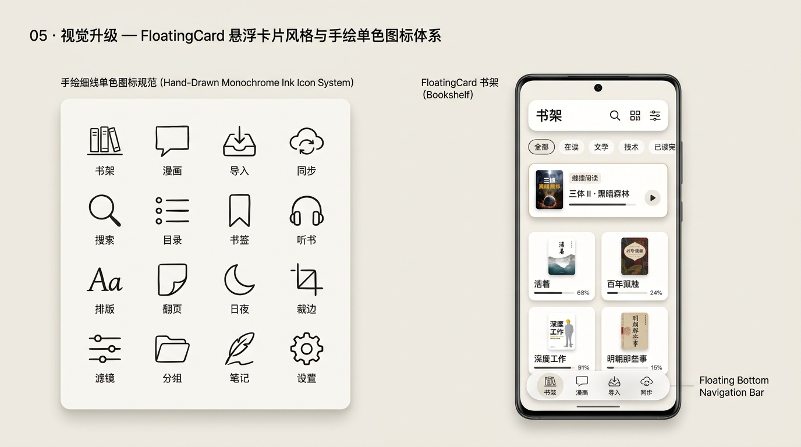
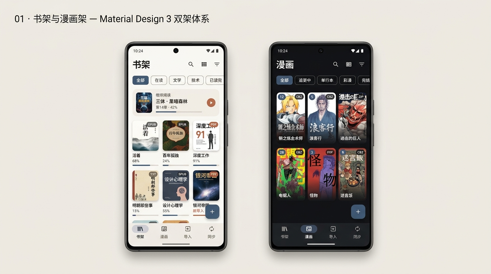
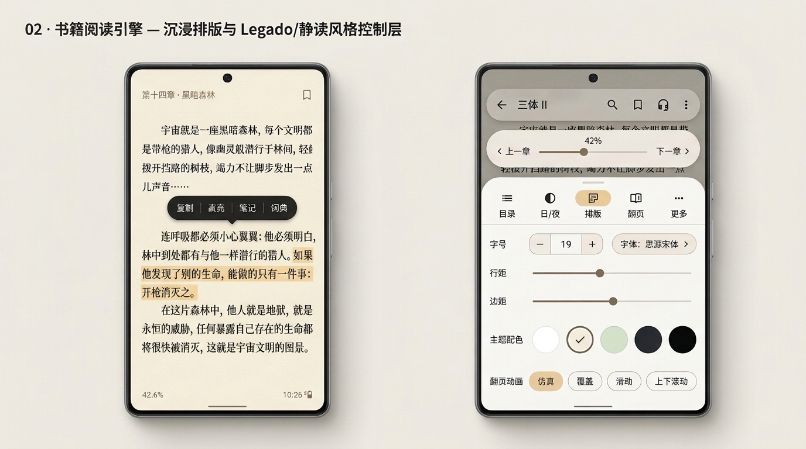
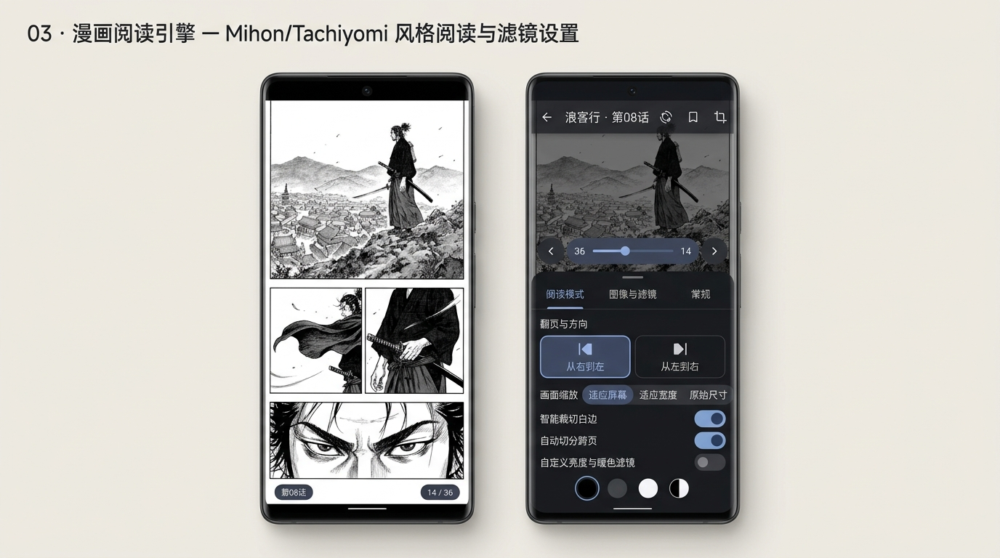
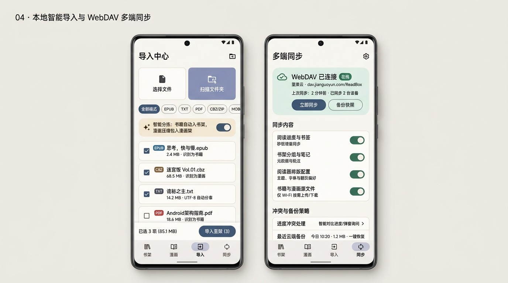
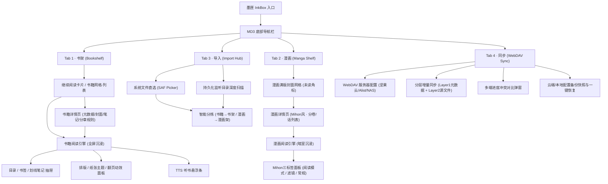
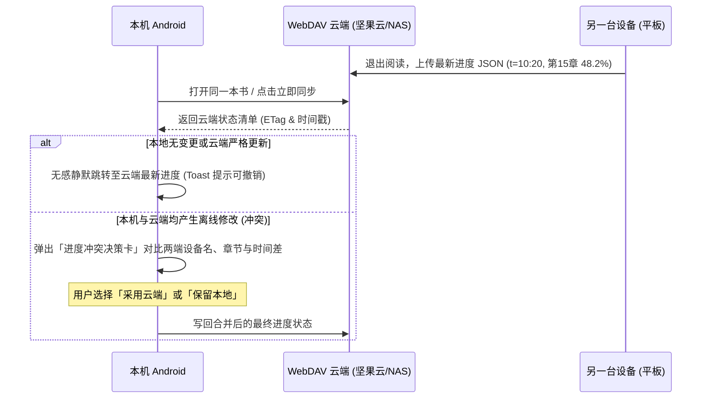

# 墨匣（InkBox）— Android 本地书籍与漫画阅读器设计规范

> **阶段**：Phase 1（v0.2 修订版，已融入 FloatingCard 悬浮卡片与手绘单色线性图标规范，并锁定 V1.0 全量范围）  
> **暂定代号**：墨匣 / InkBox  
> **目标平台路线**：Android（V1.0 首发）→ iOS → Windows → 鸿蒙 (HarmonyOS NEXT) → macOS  
> **交互原型 (v0.2)**：点击打开 [prototype.html](./prototype.html) 切换对比 **FloatingCard 悬浮风** 与 **手绘单色图标**  
> **Phase 2 技术选型**：详见 [tech_selection.md](../architecture/tech_selection.md)

---

## 1. 产品定位与开源标杆借鉴

本应用聚焦 **「纯粹本地阅读 + 书籍漫画双引擎 + 无感多端同步」**，不做网络爬虫书源或广告信息流，把体验极致集中在本地文件管理、排版渲染、漫画流畅度与多端数据一致性上。

| 参考项目 | 核心借鉴亮点 | 本应用融合取舍 |
| :--- | :--- | :--- |
| **Legado (阅读R / Sigma / NG / MD3)** | 极高自由度的排版控制、九宫格自定义点击区、TXT 正则分章与净化规则、WebDAV 备份习惯、MD3 现代化动效与智能分组 | 保留其最强悍的「本地排版 + 点击区 + WebDAV」，剔除复杂的网络书源/发现页，保持界面克制清爽 |
| **静读天下 (Moon+ Reader)** | 极佳的仿真翻页质感、丰富的纸张纹理/护眼主题、划词高亮与笔记体系、PDF 重排与自动滚屏 | 吸收其纸感审美、划词批注浮层与阅读统计仪式感，用 MD3 重塑过时的传统控件 |
| **Mihon / Tachiyomi** | Material Design 3 (Material You) 视觉典范、满版封面+未读角标漫画架、单作独立阅读配置、极顺手的三标签阅读器底部面板（阅读模式/滤镜/常规） | 完整继承其漫画架与漫画阅读器心智模型，并针对「本地压缩包 / 文件夹」重构免解压流式浏览体验 |

---

## 2. 高保真 UI 设计图总览

四组高保真设计图采用统一的 **Material Design 3 (Material You) × 温润纸感编辑风** 视觉语言，覆盖全部 6 大核心模块：

````carousel

<!-- slide -->

<!-- slide -->

<!-- slide -->

<!-- slide -->

````

> [!NOTE]
> 上述第 3 组「漫画阅读引擎」设计图在「翻页与方向」区域示意了左右翻页双卡片；在实际应用及可交互原型 [prototype.html](./prototype.html) 中，该区域完整提供 **4 种模式**（从右到左 / 从左到右 / 条漫滚动 / 双页拼接）的 2×2 卡片切换。

---

## 3. 信息架构与导航流转（IA）

底部采用 Android MD3 标准 **4-Tab 导航栏**（`书架` / `漫画` / `导入` / `同步`），将最高频的「导入」与「多端同步」平级前置，避免藏在多层设置抽屉中；应用级设置（主题、存储清理、阅读统计、关于）位于各顶栏右上角统一入口或「同步/我的」设置页。



---

## 4. UI 设计规范（Design System）

### 4.1 视觉风格与色彩体系

采用 **Material Design 3 + Dynamic Color (Monet)** 架构，默认提供一套高辨识度的 **「青墨暖纸 (Slate Ink & Warm Paper)」** 品牌主题，并允许用户一键开启跟随系统壁纸取色。

| 语义角色 | 日间纸感模式 (Light) | 暗夜护眼模式 (Dark) | OLED 纯黑模式 | 使用场景 |
| :--- | :--- | :--- | :--- | :--- |
| **Background 背景** | `#FAF8F4` | `#121316` | `#000000` | 全局页面底色、漫画阅读默认暗室底色 |
| **Surface 卡片层** | `#FFFFFF` | `#1B1D22` | `#101114` | 续读卡片、导入文件项、WebDAV 配置卡、BottomSheet |
| **Surface Variant** | `#F1EDE5` | `#24272E` | `#1A1C20` | 搜索框、未激活胶囊芯片、图标按钮底衬 |
| **Primary 主色（青墨）** | `#3B5978` | `#82A9D4` | `#82A9D4` | 主 CTA、选中态导航胶囊、进度条、开关激活态 |
| **Secondary 点缀（赭石）** | `#B86B4B` | `#D88B6A` | `#D88B6A` | 续读播放按钮、书签缎带、文本高亮强调 |
| **Success 状态绿** | `#2E7D5B` | `#55B388` | `#55B388` | WebDAV 在线状态、已读完标记、同步成功反馈 |
| **On-Surface 主文字** | `#1C1B1F` | `#EAE8E3` | `#D4D2CD` | 标题、正文、操作项 |
| **Muted 辅助文字** | `#66615B` | `#9A9893` | `#7E7D79` | 作者名、章节副标、页码、文件大小 |

### 4.2 书籍阅读器内置 5 套专业纸张主题

| 主题名 | 纸面色 | 文字墨色 | 辅助色 | 高亮底色 | 适用环境 |
| :--- | :--- | :--- | :--- | :--- | :--- |
| **纸白** | `#FFFFFF` | `#1D1D1F` | `#7A7A80` | `#FFE599` | 明亮室内 / 高对比阅读 |
| **羊皮纸（默认）** | `#F5EFE2` | `#32291E` | `#877865` | `#EED29A` | 全天候舒适阅读（可叠加微弱纸纹） |
| **护眼绿** | `#DCE8DB` | `#233324` | `#5E7560` | `#BCE0B8` | 长时间连读缓解视疲劳 |
| **深灰夜** | `#1E2024` | `#C8C6C0` | `#777980` | `#463E26` | 弱光夜间阅读（低对比不刺眼） |
| **OLED 纯黑** | `#000000` | `#A8A8A8` | `#5A5A5A` | `#332C18` | 全黑卧室 / OLED 极致省电 |

### 4.3 字体、圆角与间距系统

- **UI 字体**：跟随系统无衬线字体（Roboto / 思源黑体 / 鸿蒙黑体），数值/页码/进度统一启用 `tabular-nums` 等宽数字避免翻页跳动。
- **书籍正文字体**：内置 1 款轻量优雅衬线体（如思源宋体/霞鹜文楷）+ 支持用户导入本地 `.ttf` / `.otf` 字体文件并自动同步字体名偏好。
- **圆角规范**：
  - 书籍/漫画封面卡片：`10dp`–`12dp`
  - 信息卡片 / 导入列表项：`16dp`–`20dp`
  - MD3 底部弹出面板（BottomSheet）：顶部 `28dp`
  - 胶囊筛选标签 / CTA 按钮：`Full (999dp)`
- **手势与动效**：全面适配 Android 14+ **预测性返回手势（Predictive Back）**、Edge-to-Edge 沉浸式状态栏/导航栏透明穿透。

### 4.4 FloatingCard 悬浮卡片与手绘单色图标体系（v0.2 修订规范）

根据确认意见，正式引入 **FloatingCard 悬浮卡片风格**（并在主题设置中支持与经典 MD3 贴边布局自由切换）以及 **手绘钢笔单色线性图标体系**：

- **FloatingCard 组件语言**：
  - **悬浮导航胶囊（Floating Bottom Dock）**：底栏距底部与左右边距 `12dp`–`14dp`，全圆角毛玻璃（`backdrop-blur` 90% 透明底 + `1dp` 微弱边框 + 柔和多层扩散阴影），列表内容可从胶囊下方自然滑过。
  - **悬浮顶栏与作品卡**：顶栏与每本藏书/漫画封装在 `18dp`–`22dp` 圆角、带轻质纸张投影的独立浮卡内，与暖纸基底（`#F3EFE8`）或暗室基底（`#101114`）形成柔和的立体空间层次。
  - **阅读器四边离缝浮卡（Detached Floating Controls）**：呼出书籍或漫画阅读菜单时，顶部栏、进度胶囊、底部设置面板均四周离边 `12dp`、四角全圆角 `24dp`–`26dp` 悬浮于阅读画布之上，轻盈不压迫视线。
- **手绘单色线性图标规范（Hand-Drawn Monochrome Ink Icons）**：
  - 全应用**禁止使用全彩填充图标与 Emoji**；全部功能图标采用统一 **1.65px–1.8px 钢笔/针管笔手绘微颤线性矢量路径**（`round` 线帽与拐角），自带纸本手账的温润手作感。
  - **自适应着墨**：浅色纸面着炭墨色（`#262422`），暗夜/漫画暗室着柔和粉笔白（`#EAE8E3`），选中态以青墨主色（`#3B5978` / `#82A9D4`）或柔光圆底轻点缀。
  - 完整 16 枚核心手绘图标视觉见上方 **设计图 05**，实时矢量交互效果见 [prototype.html](./prototype.html)。

---

## 5. 六大核心模块原型与交互详设

### 模块 1：书架（Bookshelf）

**核心布局**（见设计图 01 左侧）：
1. **顶栏**：标题「书架」+ 搜索图标（展开内联搜索框）+ 视图切换（3列网格 / 2列大封面 / 紧凑列表）+ 排序筛选菜单（最近阅读 / 添加时间 / 书名 / 阅读进度）。
2. **分组胶囊栏**：横向滚动胶囊，内置智能伴生分组（`全部`、`在读`、`未读`、`已读完`）+ 用户自定义分组（如 `文学`、`技术`、`轻小说`），长按胶囊可排序或重命名分组。
3. **继续阅读卡片（可配置隐藏）**：置顶展示最近阅读的一本书，显示迷你封面、当前章节名、阅读百分比进度条、云端同步状态标及一键「续读」按钮。
4. **书籍网格 / 列表**：
   - 封面右上角轻量化格式角标（`EPUB` / `TXT` / `PDF` / `MOBI`）；无封面书籍自动按书名哈希生成典雅书脊排版封面（不出现难看的灰色占位图）。
   - 封面下方 2 行以内标题 + 极细 2dp 进度条与百分比。
5. **交互细节**：
   - **轻点封面**：直接秒开进入上次阅读位置（无需经过详情页中转）。
   - **长按封面**：进入多选批量管理态（置顶、移动分组、标记已读、编辑元数据/换封面、上传/清理本地缓存、删除）。
   - **右下角 FAB (`+`)**：一键跳转至「导入中心」或拉起快速选择文件。

---

### 模块 2：漫画架（Manga Shelf）与作品详情页

**核心布局**（见设计图 01 右侧 + 原型「漫画详情页」）：
1. **Mihon 风格满版封面网格**：
   - 封面占比最大化，标题叠加在封面底部柔和黑色渐变遮罩上，彻底凸显漫画封面的视觉张力。
   - **左上角未读角标**：青墨色胶囊显示剩余未读话/卷数（如 `12`），全部读完显示绿色对勾或隐藏。
   - **右上角格式角标**：标示来源类型（`CBZ` / `CBR` / `ZIP` / `PDF` / `文件夹`）。
2. **分卷/合集结构与作品详情页**：
   - 漫画常以「单话压缩包」或「多卷嵌套目录」形式存在：导入同一作品文件夹下的多卷时，自动聚合为**一部漫画作品 + 内部多话/卷列表**。
   - 点击封面进入 **Mihon 风格漫画详情页**：高斯模糊封面顶栏 + 作者/标签/默认阅读模式芯片 + 醒目「继续阅读」主按钮 + 可正/倒序及仅看未读的章节列表。
   - 若为单卷独立压缩包，支持在设置中开启「单卷直开阅读器」，减少一次点击。
3. **独立记忆**：每部漫画独立记录其阅读模式（如日漫记住「从右到左」，韩漫彩漫记住「条漫无缝滚动」），切换作品无需反复改设置。

---

### 模块 3：书籍阅读引擎（Book Reading Engine）

**核心体验**（见设计图 02）：
1. **默认全屏无干扰**：仅在页眉极浅显示当前章节名、页脚显示 `进度%` / `页码` / `时间与电量`（支持完全隐藏进入纯白/纯黑沉浸模式）。
2. **Legado 标志性九宫格自定义点击区**：
   ```
   ┌──────────┬──────────┬──────────┐
   │  上一页  │  上一页  │  下一页  │
   ├──────────┼──────────┼──────────┤
   │  上一页  │ 呼出菜单 │  下一页  │
   ├──────────┼──────────┼──────────┤
   │  上一页  │  下一页  │  下一页  │
   └──────────┴──────────┴──────────┘
   ```
   - 预设提供「常规左右翻页」「左手单手模式」「右手单手模式（全屏点按翻下一页）」「完全自定义 9 格映射」。
   - 支持 **音量键翻页** 与蓝牙翻页器映射。
3. **呼出控制层与底部 5 键扩展面板**：
   - **顶栏**：返回、书名、全文搜索、一键书签、TTS 听书、更多（书籍详情/净化规则/导出笔记）。
   - **浮层章节进度条**：`< 上一章` + 平滑拖拽进度条（拖动时实时浮现目标章节名预览，支持撤销跳回原位）+ `下一章 >`。
   - **底部 5 项快捷栏**：
     - `目录`：滑出侧边/底部抽屉，三标签切换 **目录 / 书签 / 划线笔记**，支持定位当前章、倒序、按关键词搜章节。
     - `日/夜`：一键在「当前日间纸张」与「当前夜间主题」之间秒切。
     - `排版`：字号步进器、字体选择（含本地导入字体）、行距/段距/字距/页边距滑块、首行缩进、简繁转换、5 套纸张主题圆点、EPUB 原样式尊重/覆盖开关。
     - `翻页`：4 种翻页动效（**仿真卷曲 / 覆盖 / 左右平滑滑动 / 上下连续滚动**）+ 自动滚屏速度调节。
     - `更多`：TXT 编码手动切换、自定义分章正则规则、正文替换/净化规则、阅读计时与屏幕常亮。
4. **划词批注与多媒体**：
   - 长按拖动选字后弹出黑色悬浮胶囊：`复制` | `多色高亮` | `写想法笔记` | `查词典` | `全文检索`。
   - EPUB 内嵌插图支持点击全屏双指缩放查看，脚注支持浮窗预览不打断正文阅读。
   - **PDF 双模阅读**：支持「原版页面缩放 + 自动切白边」以及「纯文本重排模式（Reflow）」。

---

### 模块 4：漫画阅读引擎（Manga Reading Engine）

**核心体验**（见设计图 03）：
1. **暗室全幅画布**：默认 `#0B0C0E` 暗室背景，漫画画面满屏贴合；默认仅在底角保留低透明度页码胶囊（`14 / 36`）与章节名，可彻底隐藏。
2. **4 大阅读模式（完美覆盖日漫 / 美漫 / 韩漫 / 折叠屏）**：
   - **从右到左（RTL）**：标准日漫单页翻页，进度条自动镜像从右向左推进，点左侧翻下一页。
   - **从左到右（LTR）**：欧美漫画 / 国漫页漫单页翻页。
   - **条漫连续无缝滚动（Webtoon）**：垂直无缝拼接长图，消除页间缝隙，支持边缘留白比例设置，专治全彩韩漫/国漫。
   - **双页拼接模式（Dual Page）**：横屏、平板或折叠屏展开时自动双页并排（自动识别封面单页不拆错），完美还原实体漫画摊开感。
3. **Mihon 风格底部三标签控制面板**：
   - **控制浮层**：顶部半透明栏（返回、漫画名与当前话、快捷裁边开关、屏幕方向锁）+ 底部悬浮胶囊页码条（带章节前后切换箭头，拖动实时显示页面缩略图气泡）。
   - **Tab 1 · 阅读模式**：翻页方向 4 模式选择、画面缩放策略（适应屏幕 / 适应宽度 / 适应高度 / 原始尺寸 / 智能拉伸）、跨页宽图自动切分（自动按 RTL/LTR 拆成两屏阅读）。
   - **Tab 2 · 图像与滤镜**：
     - **智能裁切白边**：实时像素边缘检测裁除扫描白边，让手机小屏画面增大 15%–25%。
     - **画布背景色**：纯黑 / 深灰 / 纸白 / 智能吸取页面边缘自适应底色。
     - **自定义亮度与色彩滤镜**：支持低于系统最低亮度的暗室调光、夜间暖色护眼滤镜、黑白漫画对比度增强。
   - **Tab 3 · 常规与手势**：Mihon 经典点击区域布局选择（L型单手 / 边缘 / Kindle / 禁用点击）、双指缩放与双击智能局部放大、音量键翻页、预加载缓冲页数（默认前后 3–5 页零白屏）。

---

### 模块 5：本地智能导入中心（Smart Local Import）

**核心体验**（见设计图 04 左侧）：

#### 支持的完整格式矩阵

| 类别 | 支持格式 | 解析与交互特性 |
| :--- | :--- | :--- |
| **电子书籍** | `EPUB` (2/3)、`TXT`、`PDF`、`MOBI` / `AZW3`、`FB2`、`MD` | EPUB 解析 OPF 元数据/目录/CSS/插图；TXT 自动检测编码 (`UTF-8`/`GB18030`/`UTF-16`) 并按内置/自定义正则毫秒级分章；PDF 提取目录与首页封面 |
| **漫画 / 画集** | `CBZ` / `ZIP`、`CBR` / `RAR`、`CB7` / `7Z`、`PDF` (图像模式)、**本地图片文件夹** (`JPG`/`PNG`/`WebP`/`AVIF`) | **免解压流式索引**，直接从压缩包读取单页图像流，不额外占用存储；自动解析 `ComicInfo.xml` 元信息；嵌套目录自动归档为「漫画→分卷/话」层级 |

#### 三种无感导入路径
1. **系统文件直选**：通过 Android SAF 一次单选或多选文件直接入库；同时注册系统 `Open With` / 分享意图，在微信/QQ/文件管理器点击书籍或漫画文件可直接用墨匣打开并询问入架。
2. **持久化目录扫描与自动监听**：授权 1 个或多个常用目录（如 `/Download/Books`、`/Comics`），打开导入中心或下拉刷新时自动增量发现新文件。
3. **智能分拣引擎**：
   - 自动依据扩展名与内容特征分流：`EPUB`/`TXT`/`MOBI`/`AZW3` → **书架**；`CBZ`/`CBR`/`CB7`/含图压缩包/图片文件夹 → **漫画架**；`PDF` 自动检测图文比例（纯图像扫描 PDF 提示归入漫画架，文本型 PDF 归入书架，并允许用户一键手动切换归属）。
   - 通过 **文件头+大小/SHA-256 哈希去重**，防止同一本书反复导入产生副本。

---

### 模块 6：WebDAV 多端同步（WebDAV Multi-Device Sync）

**核心体验**（见设计图 04 右侧）：

针对手机、平板、墨水屏多设备协同，以及国内 **坚果云（存在严格请求频率限制）**、Alist、Nextcloud、群晖 NAS 等主流服务特性，设计 **「双层解耦同步架构」**：

| 同步层级 | 数据内容 | 数据体量 | 触发时机 | 传输策略 |
| :--- | :--- | :--- | :--- | :--- |
| **Layer 1 · 轻量状态层** | 阅读进度（书/漫画精确位置与时间戳）、书签、划线与笔记、书架分组与元数据、阅读器排版/主题/点击区偏好 | `< 500 KB` (压缩 JSON) | 退出阅读器自动静默同步 / 打开书籍前快速拉取 / 手动一键同步 | 单次打包合并增量读写，极低请求次数（完美规避坚果云 429 限流） |
| **Layer 2 · 源文件层（可选）** | 书籍与漫画原始文件（`.epub`/`.cbz` 等） | 数 MB ~ 数百 MB | 仅 Wi-Fi 条件下按需上传；新设备书架显示「云端可下载」角标，点击即流式拉取缓存 | 基于文件 SHA-256 去重命名，支持断点续传与自定义单文件上限阈值（如 >200MB 仅手动同步） |

#### 多端同步与冲突解决时序



#### 云端目录结构设计（透明、可读、方便手动管理）
```text
/InkBox/
├── sync/
│   ├── library_meta.json       # 书架/漫画架元数据与分组结构
│   ├── progress_index.json     # 全量阅读进度与设备时间戳索引
│   ├── annotations/            # 按书籍哈希存放的书签、高亮与笔记
│   └── preferences.json        # 阅读器排版、主题、点击区等全局配置
├── library_files/              # Layer 2 按需同步的书籍/漫画源文件（可选开启）
└── backups/                    # 定时或手动生成的全量备份快照 .zip（支持一键换机恢复）
```

---

## 6. V1.0 锁定范围与 Phase 2 衔接

根据您的确认，**V1.0 首发全量包含**以下全部能力：
- **视觉与交互**：FloatingCard 悬浮卡片体系（支持与经典 MD3 贴边布局一键切换）+ 全套手绘单色线性矢量图标。
- **书籍阅读引擎**：EPUB / TXT / PDF（原版缩放 + 智能文本重排）/ MOBI / AZW3 / FB2 / MD、仿真卷曲翻页动效、九宫格自定义点击区、划词批注笔记、TTS 语音听书。
- **漫画阅读引擎**：CBZ/ZIP、CBR/RAR、CB7/7Z、PDF、图片文件夹免解压流式读取、RTL/LTR/条漫/双页拼接、智能白边裁切、跨页宽图自动切分、滤镜调光。
- **WebDAV 多端同步**：Layer 1（进度/书签/笔记/分组/配置增量同步 + 冲突决策 + 快照备份）+ Layer 2（书籍/漫画源文件 Wi-Fi 按需同步与去重）。

下一步请审阅 **Phase 2 技术选型与五端架构方案**：[tech_selection.md](../architecture/tech_selection.md)（同步存档于 [e:/code/read/docs/architecture/tech_selection.md](file:///e:/code/read/docs/architecture/tech_selection.md)）。
